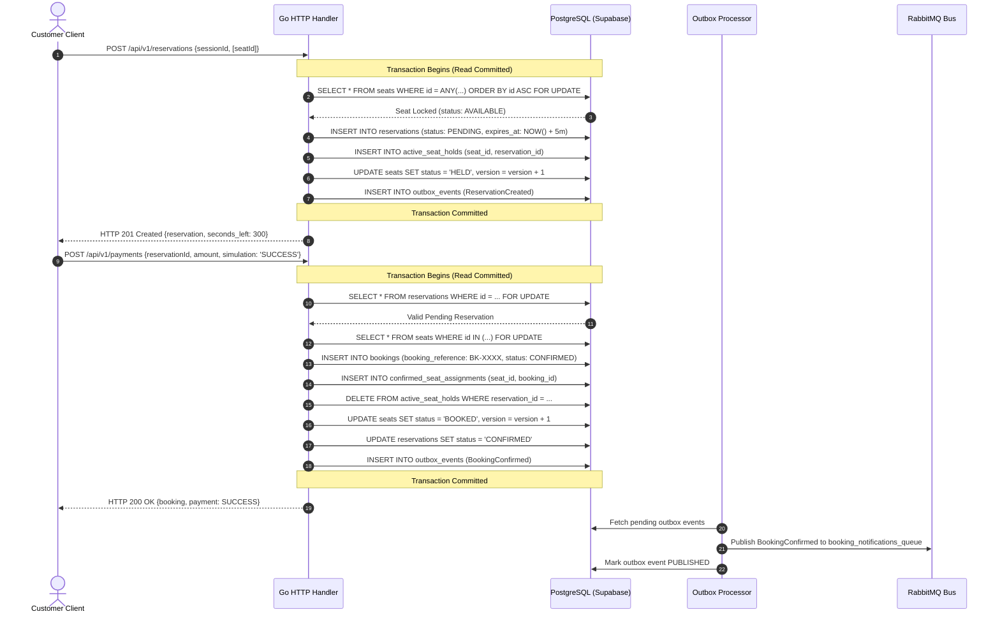
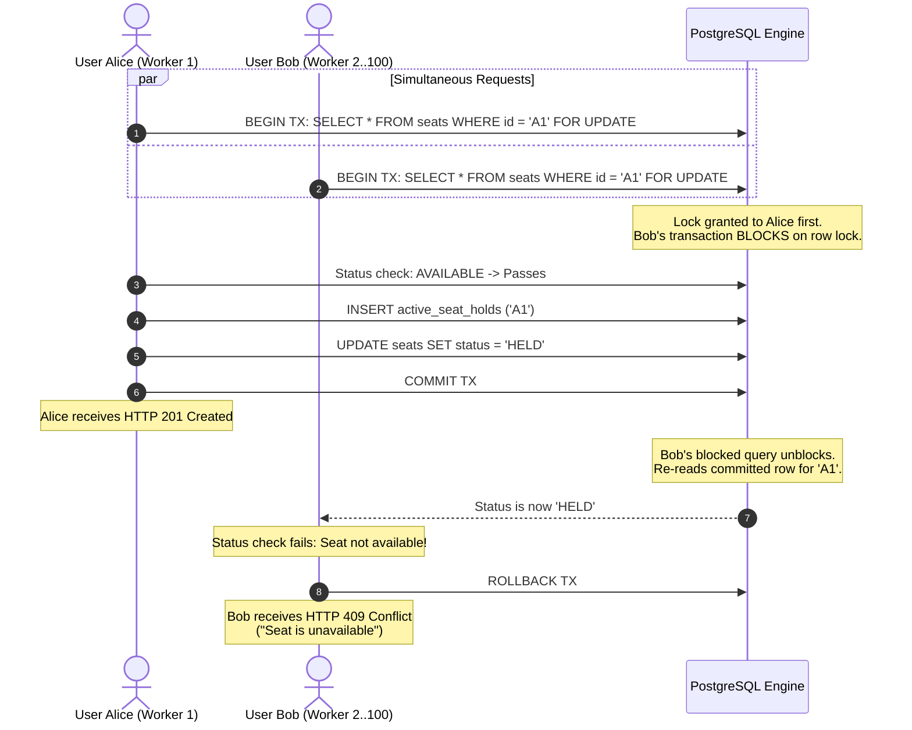
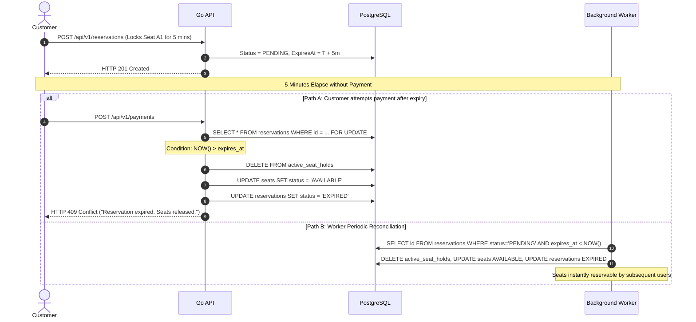
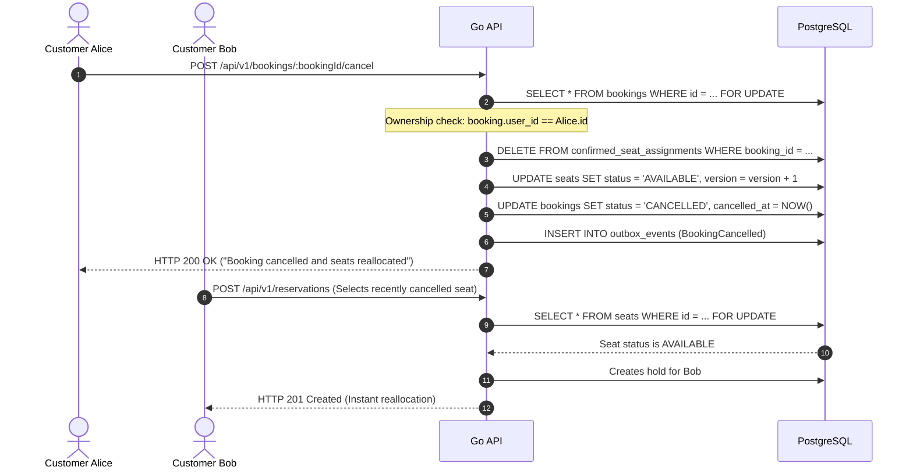
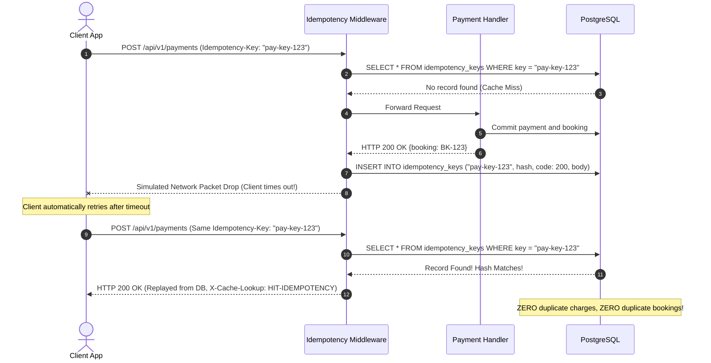

# Booking Workflows & State Machine Architecture

This document diagrams all core transactional and asynchronous workflows implemented in the Seat Reservation System.

---

## 1. Normal Reservation & Successful Payment

---

## 2. Concurrent Contention for the Same Seat (100 Simultaneous Requests)

---

## 3. Temporary Reservation Expiry & Reconciliation

---

## 4. Cancellation and Safe Seat Reallocation

---

## 5. Idempotent Retry on Network Timeout

