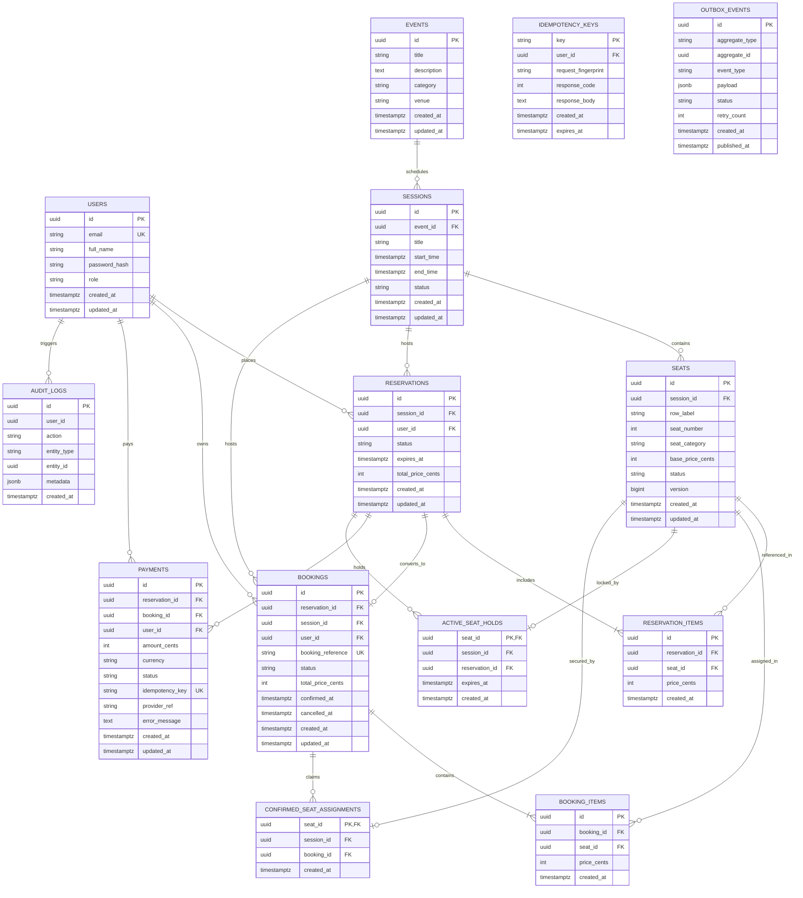

# Database Design & Entity Relationship Diagram (ERD)

## 1. Relational Architecture Overview

The database design adheres to 3NF relational normalization while enforcing transactional integrity through database-level constraints. PostgreSQL (Supabase) serves as the authoritative source of truth for all seat inventories, holds, bookings, and payments.

### Invariant Protections
1. **Zero Double-Bookings Guarantee**: Enforced by primary key uniqueness on `confirmed_seat_assignments(seat_id)`.
2. **Single Active Hold Guarantee**: Enforced by primary key uniqueness on `active_seat_holds(seat_id)`.
3. **Deadlock Elimination**: Queries acquiring multiple seat locks sort seat IDs in strict ascending order (`ORDER BY id ASC FOR UPDATE`).
4. **Reliable Asynchronous Operations**: Transactional outbox table (`outbox_events`) populated in the exact same database transaction as bookings or cancellations.

---

## 2. Mermaid Entity Relationship Diagram



---

## 3. Database Constraints & Schema Design Decisions

### A. Two-Tier Protection Mechanism
1. **Tier 1: Application Row Locking (`SELECT ... FOR UPDATE`)**:
   - Ensures that only one transaction examines and mutates an available seat at any instant.
   - Prevents read-modify-write race conditions.
2. **Tier 2: Database Table-Level Physical Constraints (`PRIMARY KEY`)**:
   - `active_seat_holds` has `seat_id` as its primary key. Even if application code failed, PostgreSQL would physically reject any second concurrent hold with error code `23505` (unique_violation).
   - `confirmed_seat_assignments` has `seat_id` as its primary key. A seat can physically never be assigned to more than one confirmed booking.

### B. Natural Seat Uniqueness
```sql
CONSTRAINT uq_session_row_seat UNIQUE (session_id, row_label, seat_number);
```
Guarantees that duplicate seat definitions within the same session cannot exist.

### C. State Machine Constraints
```sql
CONSTRAINT chk_seat_status CHECK (status IN ('AVAILABLE', 'HELD', 'BOOKED', 'UNAVAILABLE'));
CONSTRAINT chk_reservation_status CHECK (status IN ('PENDING', 'CONFIRMED', 'EXPIRED', 'CANCELLED'));
CONSTRAINT chk_booking_status CHECK (status IN ('CONFIRMED', 'CANCELLED'));
CONSTRAINT chk_payment_status CHECK (status IN ('PENDING', 'SUCCESS', 'FAILED', 'TIMEOUT'));
```
Enforces valid state machine values across all tables.
